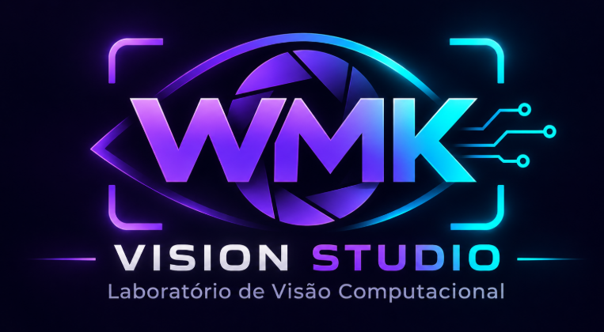

<div align="center">



# WMK VISION STUDIO

**Uma central gratuita para aprender visão computacional com vídeos reais — em português, do zero.**

[Primeiro contato](manuais/PRIMEIRO-CONTATO.html) · [Entenda os conceitos](manuais/CONCEITOS.html) · [Experimentos](manuais/EXPERIMENTOS.html) · [Placas e OCR](manuais/OCR-PLACAS.html) · [Guia do desenvolvedor](manuais/DESENVOLVEDOR.html) · [Perguntas frequentes](manuais/PERGUNTAS-FREQUENTES.html)

**Projeto WMK e documentação:** Walney Moreira Klein — walneyk@hotmail.com

</div>

> **Comece por aqui:** não precisa saber o que é YOLO para utilizar o Studio. Vamos explicar cada conceito, por que ele existe, o que está funcionando e o que ainda é uma proposta. Os vídeos são processados localmente, sem precisar enviar suas gravações a uma API de IA.

## O que é visão computacional?

É a área que cria programas capazes de **extrair informações de imagens e vídeos**. Exemplo: localizar carros em cada quadro, acompanhar o mesmo carro ao longo do tempo e contar quando ele cruza uma linha. Detectar um objeto NÃO é a mesma coisa que identificá-lo pessoalmente, nem garante que toda detecção esteja correta.

**As peças, sem mistério:**

| Nome | Explicação para iniciantes | Aqui no Studio |
|---|---|---|
| **YOLO** | Modelo de IA treinado para localizar certas categorias de objetos e desenhar uma caixa em volta | Detecta objetos |
| **ByteTrack** | Algoritmo que tenta conservar o ID de um objeto entre quadros | Rastreia carros e pessoas |
| **Supervision** | Biblioteca Python de apoio à análise visual, linhas, anotações e contagem | Desenha caixas e conta cruzamentos |
| **OCR** | Tecnologia que lê letras e números presentes em uma imagem | **Ainda não implementado** |
| **FPS** | Quadros por segundo. FPS da gravação e FPS de processamento são medidas diferentes | Exibido nos relatórios |
| **Confiança** | Pontuação estimada pelo modelo, não uma garantia matemática de acerto | Controle deslizante |

Fluxo: **vídeo → quadros → YOLO detecta → ByteTrack rastreia → Supervision anota/conta → MP4 + JSON + métricas**.

## O que funciona hoje (v1.2)

- Importação de vídeos MP4, MOV, AVI, MKV, WEBM e M4V.
- Biblioteca de 10 exemplos para baixar sob demanda, quando a origem estiver acessível.
- Escolha de modelos YOLO11 Nano, YOLO11 Small ou YOLOv8 Nano; CPU por padrão.
- Ajuste de confiança, tamanho de inferência, intervalo de quadros e largura de saída.
- **Uma linha horizontal** de contagem, ajustável na prévia.
- Identificação por classe, rastreamento ByteTrack, caixas, IDs e trajetórias.
- Vídeo anotado, relatório JSON, eventos de cruzamento e logs em arquivo.
- Interface web local, manuais HTML e créditos WMK.

**Não implementado ainda:** leitor de placas, OCR, câmeras IP em tempo real, várias linhas e polígonos editáveis, comparação automática entre experimentos, base SQLite e agente LLM. Não confunda o roteiro de estudo com recursos já disponíveis.

## Instalação no Windows 10/11 (modo iniciante)

**Você precisa:** Windows, espaço livre em D:, Python 3.12 ou 3.13 instalado e internet para baixar pacotes e pesos dos modelos. GPU não é obrigatória: o projeto funciona em CPU, com processamento potencialmente mais lento. Git é opcional se baixar ZIP.

1. Baixe o repositório usando **Code → Download ZIP** no GitHub ou execute `git clone https://github.com/WalneyNF/WMK-VISION-STUDIO.git`.
2. Extraia na pasta `D:\Ferramentas\WMK-VISION-STUDIO` (evite pasta aninhada duas vezes).
3. Dê dois cliques em **`INSTALAR.cmd`**. O script cria `.venv` e instala dependências. Se der erro, consulte `logs\instalacao.log`. A janela permanece aberta.
4. Execute **`INICIAR.cmd`** e abra **http://127.0.0.1:8767**.
5. Para atualizar dependências de uma instalação anterior, use **`CORRIGIR-DEPENDENCIAS.cmd`** e reinicie o servidor.

**Observação:** o projeto já foi exercitado com o vídeo `vehicles.mp4` no computador do mantenedor. O ambiente de cada usuário pode apresentar problemas específicos de codecs, drivers, versões ou conexão. O modelo escolhido pode ser baixado na primeira execução.

### Usar pelo terminal

```powershell
cd D:\Ferramentas\WMK-VISION-STUDIO
py -3.13 -m venv .venv
.\.venv\Scripts\python.exe -m pip install -r requirements.txt
.\.venv\Scripts\python.exe app.py
```

Se o Python 3.13 não estiver instalado, substitua por `py -3.12`.

### Primeira experiência: uma rodovia

1. Abra a aplicação e a seção **Biblioteca de vídeos**.
2. Escolha **Trânsito: veículos** e clique em **Baixar e carregar exemplo**; ou envie `vehicles.mp4` manualmente.
3. Escolha **YOLO11 Nano**, **CPU**, **416 px** e **35%** de confiança.
4. Deixe ativado **Somente veículos** e arraste a linha para uma posição atravessada por veículos.
5. Clique em **Iniciar análise do vídeo**; acompanhe as métricas e os logs.
6. Assista ao vídeo processado, abra o JSON e compare os eventos. **Entradas/saídas são direções relativas à linha; não significam necessariamente entrada/saída da rodovia.**

Um teste anterior de referência mostrou **538 quadros, 3 entradas, 4 saídas**. É um resultado de uma execução específica, não um valor que outros usuários devam necessariamente reproduzir.

## Teste outras cenas sem programar

| Cena no catálogo | O que observar | Filtro “Somente veículos” |
|---|---|---|
| Trânsito: veículos | Classes, IDs, cruzamentos | Ligado |
| Trânsito: segunda cena | Mudança de cena/iluminação | Ligado |
| Pessoas caminhando | Pessoas e oclusões | **Desligado** |
| Praça pública | Fluxo e objetos pequenos | **Desligado** |
| Mercado / comércio | Pessoas parcialmente escondidas | **Desligado** |
| Estação de metrô | Multidões e troca de IDs | **Desligado** |
| Indústria / garrafas | Limitações do modelo genérico | **Desligado** |
| Praia | Pessoas distantes | **Desligado** |
| Basquete | Movimento rápido e oclusões | **Desligado** |
| Esqui | Movimentos e fundo complexo | **Desligado** |

Alguns exemplos podem estar indisponíveis no servidor externo. Se um download falhar, registre a mensagem do painel de diagnóstico ou envie um vídeo local com autorização de uso. **Garrafas, placas, defeitos e produtos especializados podem não pertencer às categorias reconhecidas pelo modelo escolhido.**

## Como aprender de verdade — roteiro sugerido

| Aula | Objetivo | Experimento |
|---|---|---|
| 01 | Detecção | Rodovia com YOLO Nano |
| 02 | Confiança | Mesmo vídeo com 25%, 35%, 50% |
| 03 | Resolução | Mesmo vídeo com 416, 640 e 960 px |
| 04 | Rastreamento | Pessoas caminhando; observe IDs |
| 05 | Contagem | Ajuste a linha em diferentes posições |
| 06 | Limitações | Indústria e objetos não conhecidos |
| 07 | Avaliação | Compare contagem com anotação manual |
| 08 | OCR (conceitual) | Entenda o pipeline de placas, ainda não implementado |

Abra os manuais HTML offline para explicações passo a passo e exercícios.

## Arquivos importantes

```text
WMK-VISION-STUDIO/
├── app.py                 # Servidor Flask e processamento
├── static/                # JavaScript, CSS e logo
├── templates/             # Página do Studio
├── assets/                # Paleta visual WMK
├── manuais/               # Curso e documentação em HTML
├── exemplos/              # Exemplos, presets e resultados demonstrativos
├── tests/                 # Verificações sem baixar modelos
├── INSTALAR.cmd
├── INICIAR.cmd
├── CORRIGIR-DEPENDENCIAS.cmd
├── uploads/               # Criada na execução; arquivos locais
├── resultados/            # Criada na execução; MP4 e JSON
└── logs/                  # Criada na execução; erros e diagnóstico
```

## Dúvidas e soluções rápidas

- **`No module named 'lap'`**: rode `CORRIGIR-DEPENDENCIAS.cmd` e reinicie o programa.
- **A página abriu, mas não detecta nada**: confira arquivo, modelo, filtro de veículos e painel **Diagnóstico e logs**.
- **Processamento lento**: tente YOLO11 Nano, CPU e 416 px; evite interpretar FPS de processamento como FPS do vídeo.
- **Vídeo não toca no navegador**: o projeto tenta converter para H.264 quando encontra `ffmpeg` no PATH; o MP4 de saída pode ser baixado e aberto no VLC.
- **Não encontra placas**: a versão atual não inclui detector específico nem OCR.
- **Erro 404 ao baixar exemplo**: a disponibilidade do vídeo depende do serviço de origem; use um vídeo próprio ou outro exemplo.

Detalhes adicionais em [Perguntas frequentes](manuais/PERGUNTAS-FREQUENTES.html) e [Desenvolvedor](manuais/DESENVOLVEDOR.html).

## Privacidade, segurança e licenças

O processamento de vídeos enviados roda localmente, mas **a instalação e o download dos exemplos/modelos acessam a internet**. Não exponha o servidor Flask à internet sem autenticação, limites, proteção de uploads e revisão de segurança. Respeite consentimento, finalidade e regras aplicáveis a imagens e placas. Evite publicar gravações com informações identificáveis sem autorização.

Este aplicativo usa dependências com licenças próprias. O **Supervision** possui licença MIT; o **Ultralytics** possui termos distintos (incluindo opções AGPL/comercial): revise cada licença e a dos pesos dos modelos antes de distribuir produtos derivados. Não substitua os avisos originais de licença do seu fork.

## Contribuir e compartilhar conhecimento

Ideias de contribuição: traduzir mensagens, criar exemplos reproduzíveis, testar CPU fraca, documentar dificuldades reais, registrar tempo de processamento e propor exercícios. Ao relatar um problema, informe Windows, Python, vídeo de exemplo, configuração, mensagem e trecho de log (remova dados pessoais).

**Autor e manutenção do projeto WMK:** Walney Moreira Klein — walneyk@hotmail.com. **Agradecimentos e atribuições:** Roboflow Supervision, Ultralytics, OpenCV, Flask e respectivos contribuidores.

> **Sobre o nome do repositório:** este pacote apresenta o aplicativo WMK Vision Studio. Se seu repositório remoto ainda contiver o código-fonte completo de um fork do Supervision, preserve o histórico, as licenças e os arquivos originais; não substitua o projeto original inteiro sem revisar a integração.
